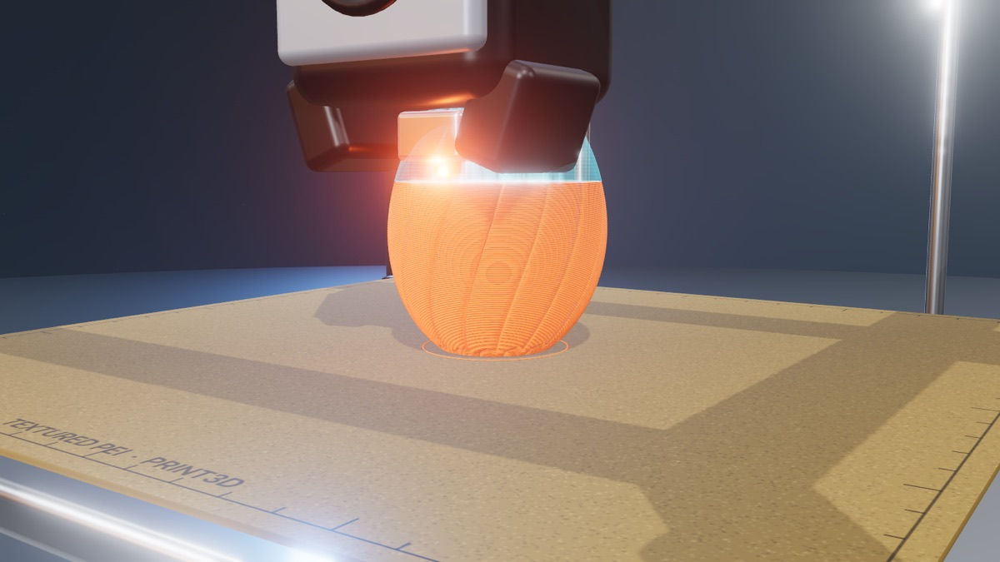

# PRINT3D

*From pixels to plastic, layer by layer.*

**▶ Live: [jorgesousa.github.io/print3d](https://jorgesousa.github.io/print3d/)**



PRINT3D shows how an FDM 3D printer really works. You drop in a model (STL, 3MF or OBJ). It is sliced in your browser, and you watch a printer heat up, level the bed and lay down every line of plastic in real-time 3D, with live G-code, temperatures and a top view of the current layer. When the print is done, you can pick it up, cut it open and play with it.

It was [Francisco Sousa](https://jorgesousa.github.io/sousa-lab/)'s idea: he wanted to see what actually happens inside the printer. It is part of **[Sousa Lab](https://github.com/jorgesousa/sousa-lab)**.

## Features

- **Your own models**: drag in an `.stl`, `.3mf` or `.obj` file (for example one downloaded from MakerWorld or Printables), or pick one of the built-in demo models. Nothing is uploaded; everything runs locally in the browser.
- **A real (simplified) slicer** in a Web Worker: layer height, infill density, walls and scale. It produces a skirt, outer and inner walls, sparse infill, solid and top skin, and the travel moves between them.
- **The whole process**, step by step: Slice → Heat → Level → Print → Cool → Inspect, with captions explaining each step.
- **Live telemetry**: nozzle and bed temperature, layer, Z height, speed, part fan, filament used and real print time left. Also a streaming G-code panel and a top-view mini-map of the current layer.
- **Playback controls**: play/pause, scrub through the print, speeds from 1× real time to 200×. Three cameras: Cinematic, Nozzle cam and Free. Toggles for feature colours, a ghost of the final model and sound.
- **"How a hotend works"**: an explainer of the extruder and hotend.
- **Inspect mode**: pop the finished part off the bed and turn it in your hands, with Float or Gravity physics. You can also cut it along X, Y or Z, explode its layers, scrub through layers and hide walls to see the infill.
- **Print-in-place models**: articulated models (chains, hinges, screw and twist joints such as fidget toys) are split into their real parts. Their joints are measured from the geometry and simulated, so you can **Flex** the model or drop it and watch it move.

## Run it locally

You need [Node.js](https://nodejs.org/) 20.19 or newer. `.nvmrc` pins 24, so `nvm use` picks it.

```bash
git clone https://github.com/jorgesousa/print3d.git
cd print3d
npm install
npm run dev        # http://localhost:5173
```

| Command | What it does |
|---|---|
| `npm run dev` | Dev server with hot reload |
| `npm run build` | Production build in `dist/` |
| `npm run preview` | Serves the `dist/` build locally |

## Deploy

Every push to `main` builds the site and publishes it to GitHub Pages ([`.github/workflows/deploy.yml`](.github/workflows/deploy.yml)). `vite.config.js` uses `base: './'`, so the build also works from any other sub-path or static host.

## Project structure

```
index.html              App shell: panels, telemetry, transport bar, Inspect controls
src/
  main.js               App state machine (phases), UI wiring, camera, HUD, G-code, mini-map
  scene.js              three.js renderer, lights, post-processing (bloom), environment
  printer.js            The procedural 3D printer model (frame, gantry, hotend, fan with the Sousa "S")
  toolpath.js           Turns sliced paths into extruded bead geometry, revealed as the nozzle moves
  slicer.worker.js      Slicer (Clipper polygon offsets/booleans): walls, infill, skin, skirt
  loaders.js            STL (binary/ASCII), OBJ and 3MF (zip via fflate) loaders, normalisation
  models.js             Built-in demo models (vase, rook, gear, planter, rocket)
  inspect.js            Inspect mode: picking, cut planes, explode, rigid and multibody physics (XPBD)
  articulate.js         Print-in-place analysis: find parts, fit hinge/slider/screw joints, verify by voxels
  articulate.worker.js  Runs the articulation analysis off the main thread
  sound.js              Synthesised stepper-motor "music" and fan noise (Web Audio)
  style.css             UI styles
docs/preview.jpg        Screenshot used in this README
```

## How it works

1. **Load**: the file is parsed into a triangle soup, oriented Z-up, centred on the bed and scaled to fit (`loaders.js`).
2. **Slice**: the worker cuts the mesh at each layer height and chains the segments into closed loops. Then it uses Clipper offsets for the walls and booleans for infill and top/bottom skin. Each path is tagged with its feature type (`slicer.worker.js`).
3. **Print**: paths become extruded "bead" geometry. The animation advances along the toolpath at the selected speed, moves the gantry and nozzle, and reveals the plastic behind the nozzle. G-code lines are generated for the moves as they happen (`main.js`, `toolpath.js`).
4. **Inspect**: the printed part becomes a rigid body. For print-in-place models, `articulate.js` finds interlocked shells across the clearance gap and fits the rigid motion each joint allows. The joints are then simulated as an XPBD multibody system (`inspect.js`).

## Built with

[three.js](https://threejs.org/) · [Clipper](https://www.npmjs.com/package/clipper-lib) · [fflate](https://github.com/101arrowz/fflate) · [Vite](https://vite.dev/)

## More docs

- [docs/DESIGN.md](docs/DESIGN.md): design decisions, rules and how to check changes
- [.github/copilot-instructions.md](.github/copilot-instructions.md): project rules for GitHub Copilot

## Credits

- Idea: **Francisco Sousa**
- Made by **Jorge Sousa**, with GitHub Copilot

## License

MIT, see [LICENSE](LICENSE). Models you load stay yours; they never leave your browser.
